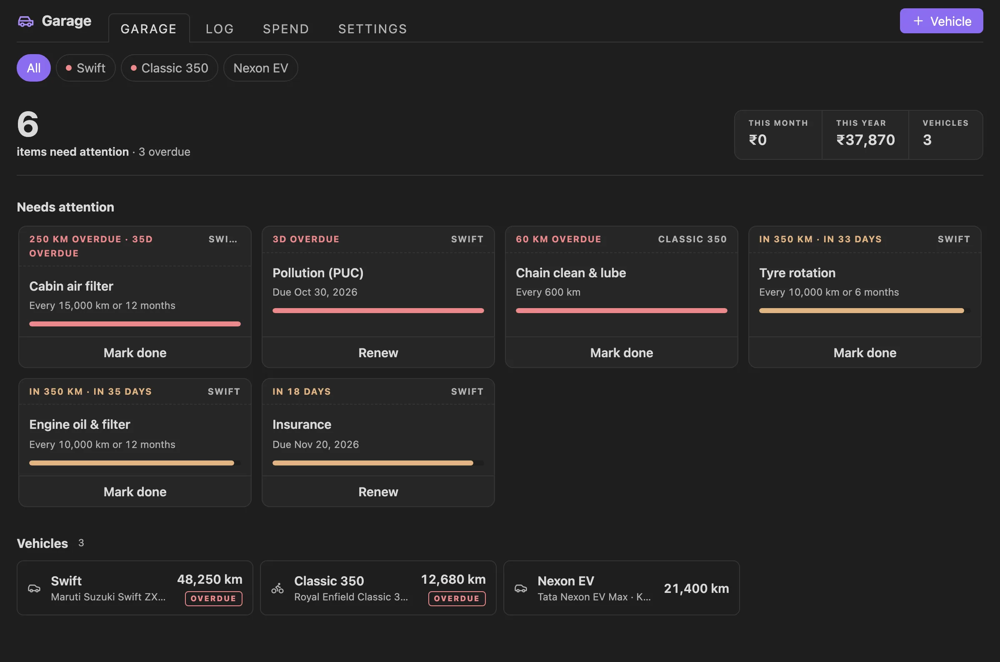
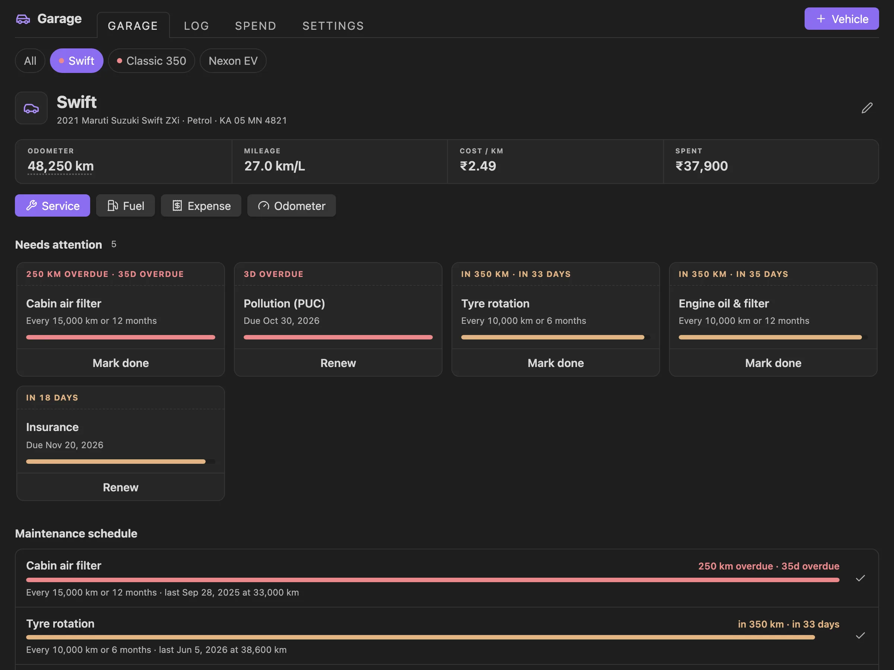
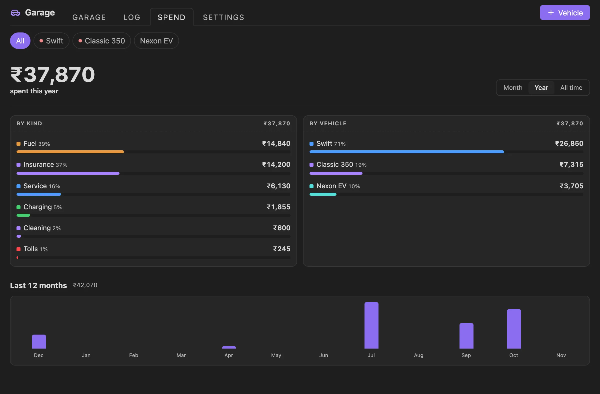
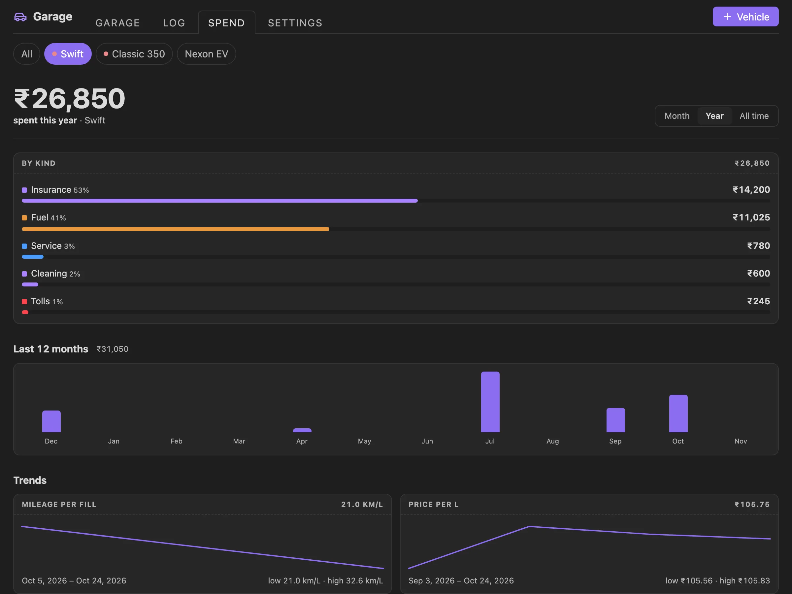
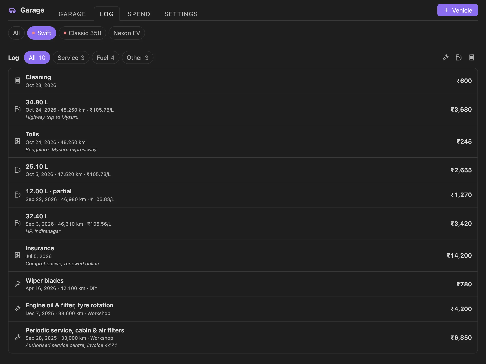
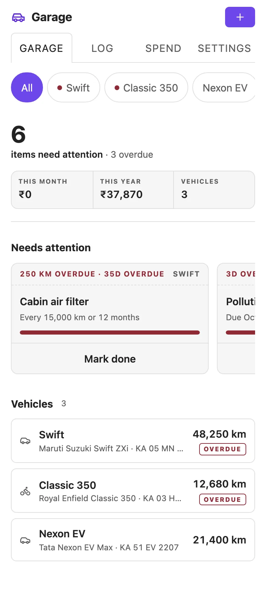
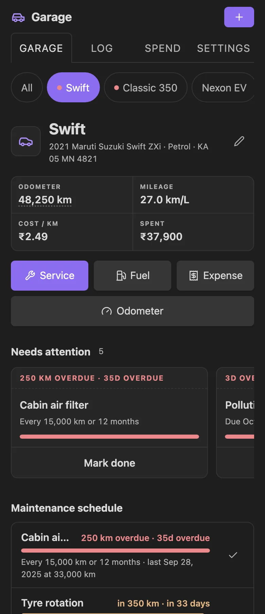
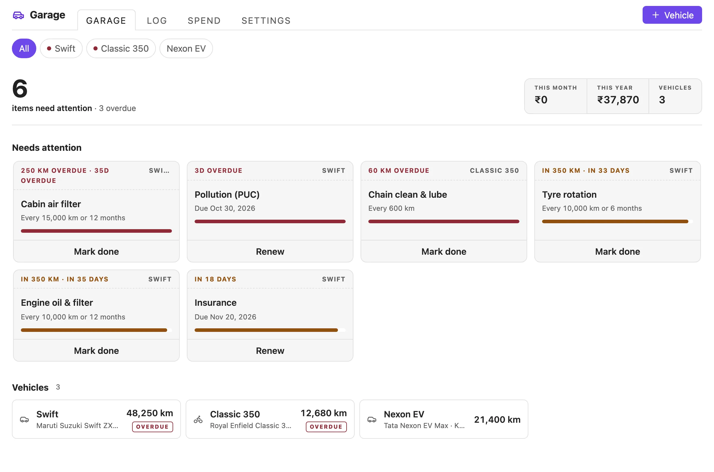

<p align="center">
  
</p>

<h1 align="center">Garage</h1>

<p align="center">
  Service schedules, fuel and charging, expenses, receipts and renewals for your cars, motorcycles, scooters and EVs, inside your Obsidian vault.<br>
  See what needs doing next, and get reminded before it is overdue.
</p>

<p align="center">
  <a href="https://github.com/varunlakshmaiah/obsidian-garage/releases/latest"></a>
  
  
  <a href="https://github.com/varunlakshmaiah/obsidian-garage/actions/workflows/test.yml"></a>
  <a href="LICENSE"></a>
</p>

<p align="center">
  
</p>

## Why Garage

Car apps want an account, show ads, and keep your history on their servers. Garage keeps everything in your vault, works offline, and opens on the one question that matters: **what needs doing next?**

- Service items due by distance or by months, whichever comes first, with ready-made schedules for cars, motorcycles, scooters and EVs
- Insurance, pollution certificate (PUC), registration and road tax dates, with one-tap **Renew**
- Fuel and charging log with real mileage, worked out the way a fuel pump receipt would
- Every cost in one place: service, fuel, charging, insurance, EMI, tolls, parking and more
- No account, no network, no telemetry, no dependencies. Free

## Features

### What needs attention

The garage leads with everything that is overdue or due soon across all your vehicles, most urgent first. Each card says how far past or how close it is (*250 km overdue · 35d overdue*, *in 18 days*) with a progress bar and one action: **Mark done** for a service item, **Renew** for a document. Vehicle tiles below are stamped **Overdue** or **Due soon**.

### One vehicle at a glance



Pick a vehicle to see its odometer (tap to update), mileage, cost per km and total spend, then its maintenance schedule with progress bars and its documents with expiry dates.

**Logging a service** asks which schedule items the work covered. Tick them and they reset to that date and reading, so an oil change and a tyre rotation in one visit are both marked done.

### Fuel and charging

- **Mileage by the full-tank method.** Partial fills are added to the next full fill, so topping up never distorts the number. Petrol and diesel show km/L (or MPG), EVs show kWh/100 km (or mi/kWh).
- **Type any two** of litres, price per litre and cost, and the third is filled in.
- **Missed a fill?** Turn on *Missed the fuel before this* on the next one. Mileage starts over from there instead of counting two tanks as one.

### Expenses and receipts

Log costs that are not service or fuel: insurance, tax and registration, loan or EMI, parking, tolls, cleaning, fines and accessories. They count towards spend and cost per km.

Attach a receipt to any entry: pick a photo or PDF already in your vault, or tap **Add photo** to use your phone's camera. Receipts are saved to `Garage/Receipts/` and open from the entry or the log.

### Spend and trends



Spend this month, this year or all time, by kind and by vehicle, plus the last 12 months. Pick one vehicle to also see how its mileage and the price you pay per litre have moved.



### Log



Every service, fill, charge and expense, newest first, filtered by kind. Tap an entry to edit it; right-click or long-press to edit, open its receipt or delete it. Every delete has **Undo**.

### Reminders

Once a day, when your vault opens, a notice lists what is overdue or due soon, with a button to open the garage. Turn it off in settings, or run **Show what needs attention** any time.

### In your notes

````markdown
```vehicle-garage
```
````

lists what needs attention across all vehicles, and

````markdown
```vehicle-card
vehicle: Swift
```
````

shows one vehicle's mileage, cost per km, spend and due items, with buttons to log a service or a fill. Both update as your data changes. Put them in a daily note, a vehicle note or your home page.

### Built for mobile too

<p>
  
  
</p>

Garage adapts to the width of its pane, not the window: a phone, a narrow sidebar, a split or a full tab. On narrow panes every control is at least 44px tall. It uses your theme's colours and font in light and dark mode.



### Settings and data

- Currency (24, ₹ by default), kilometres or miles, litres or gallons
- How early to warn: distance and days before an item is due. Short intervals warn within a quarter of the interval, so a monthly check is not flagged the day you do it
- Daily reminder on or off
- **Backup:** export everything to a JSON file in your vault, and import it back (merge or replace, with Undo)
- **CSV:** export every log entry as a spreadsheet. Import reads that file back, or the fuel log exported by apps like Fuelio and Drivvo

## Commands

| Command | What it does |
|---|---|
| Open garage | Opens the dashboard (also the car icon in the ribbon) |
| Add vehicle | New vehicle with a schedule that fits its type |
| Log service | Pick a vehicle, then log work done |
| Log fuel or charge | Pick a vehicle, then log a fill or charge |
| Log other expense | Pick a vehicle, then log a cost |
| Update odometer | Pick a vehicle, then enter the reading |
| Show what needs attention | The reminder notice, on demand |
| Export backup (JSON) | Everything, to a file in your vault |
| Export log (CSV) | Every log entry, as a spreadsheet |
| Import backup or CSV log | From a `.json` or `.csv` file in your vault |

## Installation

### From Community plugins

1. Open **Settings → Community plugins** and turn off Restricted mode if it is on.
2. Select **Browse**, search for **Garage**, then **Install** and **Enable**.

### Manually

1. Download `main.js`, `manifest.json` and `styles.css` from the [latest release](https://github.com/varunlakshmaiah/obsidian-garage/releases/latest).
2. Put them in `<vault>/.obsidian/plugins/garage/`.
3. Reload Obsidian and enable **Garage** under **Settings → Community plugins**.

## Privacy and network use

Garage makes no network requests. Your vehicles and log are stored only in this plugin's data file, `<vault>/.obsidian/plugins/garage/data.json`, so they travel with your vault and its sync. Exports and receipts are ordinary files in your vault. There is no account, no telemetry and no analytics.

## Importing from another app

**Import** accepts a CSV with a header row that has a date column and an odometer column. Other columns are matched by name: litres or fuel, cost or total or price, full, missed, notes. Rows go to the vehicle they name, or to one you pick. Rows already in the log (same date, odometer and cost) are skipped, so importing a file twice is harmless.

Dates such as `05/02/2024` are read day first. Numbers with a decimal comma (`1.234,5`) are not supported.

## Development

There is no build step: `main.js` and `styles.css` are the shipped files.

```bash
git clone https://github.com/varunlakshmaiah/obsidian-garage.git
cd obsidian-garage
node --test                    # logic tests
python3 -m http.server 8765    # then open http://127.0.0.1:8765/preview/index.html
```

The preview runs the real plugin in a browser against a stand-in for the Obsidian API, with fictional demo data and switches for theme, accent and pane width (full, 900, 600 and 390px).

To try changes in Obsidian, copy or symlink the repository into `<vault>/.obsidian/plugins/garage/` and turn the plugin off and on. Design rules are in [DESIGN.md](DESIGN.md).

### Releasing

Bump `version` in `manifest.json`, add it to `versions.json` and `CHANGELOG.md`, commit, then push a tag with the same number (`git tag 1.0.1 && git push origin 1.0.1`). The release workflow attaches `main.js`, `manifest.json` and `styles.css` to a GitHub release.

## Support

Found a bug or have an idea? [Open an issue](https://github.com/varunlakshmaiah/obsidian-garage/issues/new/choose).

## License

[MIT](LICENSE) © Varun Lakshmaiah
